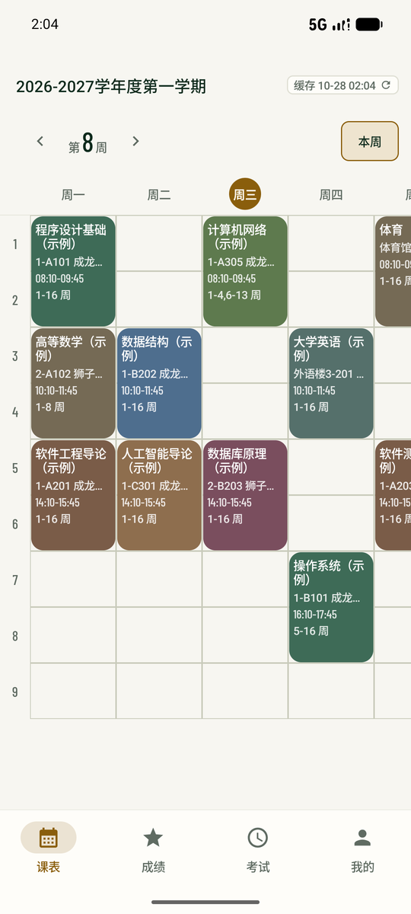
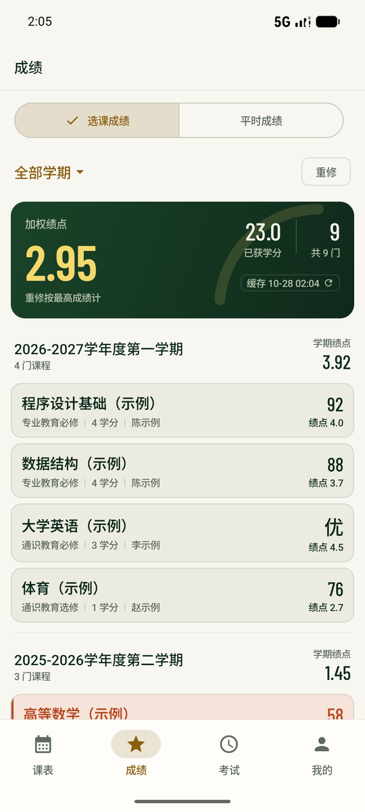
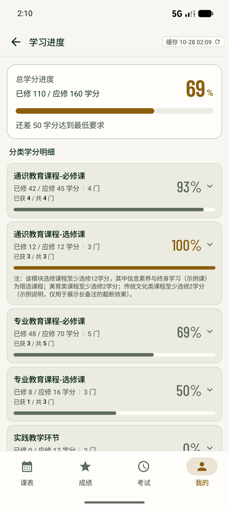
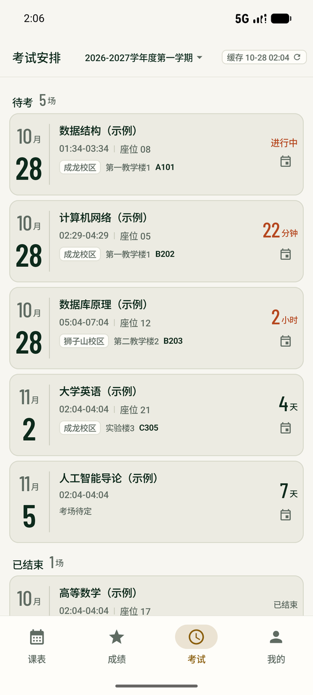
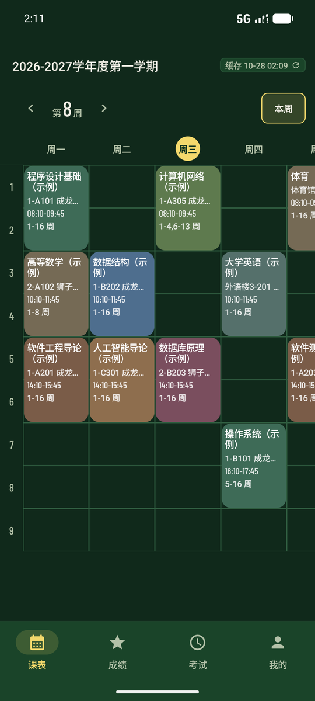

# 狮山教务（SicnuJw）

四川师范大学教务系统的**非官方** Android 客户端，Kotlin + Jetpack Compose 编写。
个人自用与学习项目，与学校无任何关联，不提供任何担保。

> 截图中的课程、成绩、姓名、学号均为虚构示例数据。

| 课表 | 成绩 | 学习进度 | 考试安排 |
|---|---|---|---|
|  |  |  |  |

深色主题：

## 发行历史

当前版本 **1.2（versionCode 17）**。完整变更见 **[CHANGELOG.md](CHANGELOG.md)**（1.0 → 1.2 的发行记录）；应用内更新只读自建服务器，GitHub Release 仅作人工下载镜像。

## 功能

- **登录**：统一身份认证（CAS + 双因子）在内嵌官方页面完成，本应用不接触密码。
- **课表**：周视图、今日高亮、上课时段、课程详情；7 天本地快照。
- **成绩**：全量成绩 + GPA、学期筛选、重修视图；按入学年份裁剪学期。
- **平时成绩**：按学期增量同步；有缓存即缓存态，进入页面不自动联网。
- **考试安排**：考场 / 座位 / 倒计时；学期裁剪与成绩同一口径。
- **学习进度**、**选课结果**、**个人信息**、**假期去向登记**。
- **应用内更新**：只走自建服务器下发的清单；GitHub Release 仅作人工下载镜像（App 不检查）；下载后校验包名 / 版本 / 签名与本机一致才交系统安装器（不静默安装）。
- **开源入口**：「我的 → 开源」，点击用系统浏览器打开本仓库。
- **诊断日志**：默认开启（可关），只存本机，导出前自动脱敏；记录页面原文与关键事件（登录/解析/网络/崩溃摘要），用于排查页面结构变化。
- 深色 / 浅色主题；离线优先，所有缓存标注时间。

## 构建

```bash
# 需要 JDK 17 与 Android SDK（compileSdk 37）
JAVA_HOME=/path/to/jdk17 ./gradlew assembleDebug
```

`minSdk 26 / targetSdk 36 / compileSdk 37`。release 签名从仓库根 `keystore.properties` 读取，
文件不存在时跳过签名（不影响 debug 构建）。

## 隐私与数据

**只收集**（登录后，每个学号前缀只成功上报一次；可在「我的 → 诊断日志」关闭）：
学号前 4 位、随机生成的匿名设备/账号标识、应用版本、Android 版本、厂商与机型、语言、首次上报时间。

**绝不收集**：完整学号、姓名、成绩、课表、考试、选课、证件照、Cookie / 票据 / 密码、
页面内容、IMEI / 序列号 / 广告 ID / 位置。

- 传输只走 HTTPS；设备标识在本机用 Android Keystore 加密存储；服务端落库前换成加盐 HMAC。
- **诊断日志默认开启、可随时关闭**，只写入应用私有目录、不联网；写入与导出各脱敏一次（本人学号与姓名、
  票据 / 会话 Cookie、密码与用户名输入框、身份证、手机号、邮箱、其余 10 位学号）后才由用户选择保存位置。
- 学工域（含假期去向登记）整域禁止抓取。
- 完整说明见 [PRIVACY.md](PRIVACY.md)。

## 许可

[MIT License](LICENSE)。第三方依赖（AndroidX、OkHttp、Jsoup、Gradle Wrapper 等）遵循各自许可。

## 免责声明

非官方客户端，与四川师范大学无任何关联。教务数据仅供参考，不作为正式依据；使用风险自负。
